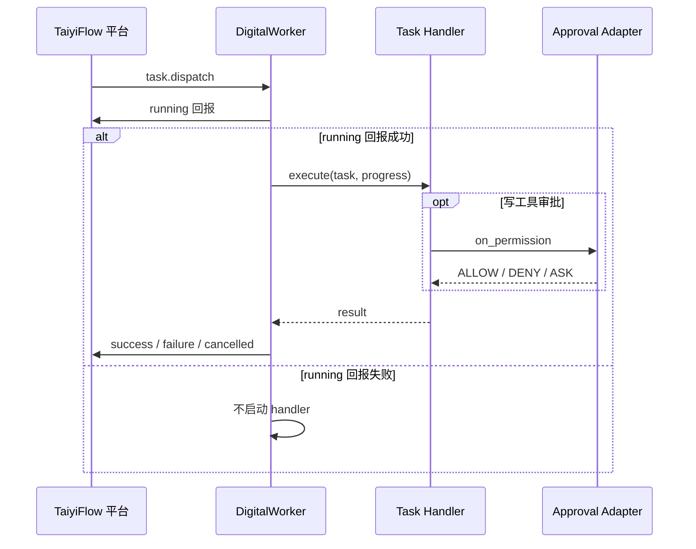

# 数字员工

`DigitalWorker` 让 Python 进程成为常驻数字员工：通过显式启用的协同连接接收任务，完成身份校验、执行、审批、平台回报、恢复对账和受控子任务。

## 运行模型



- 自定义 task handler 优先；默认任务路由到 Flow 会话，同 flow + session 串行。
- `concurrency` 限制同时执行的操作数，超出并发的已接任务进入有界队列。
- 任务必须先成功回报 running 才执行。
- 重连只自动执行平台明确 pending 且未取消的任务；其他状态只对账，不重放。
- 终态回报失败进入不确定状态，不通过重跑任务修复。
- 任务、结果、产物、checkpoint 和记忆以平台为权威。

## 安装与启动

```bash
python -m pip install -e '.[worker]'
export TAIYIFLOW_API_KEY=your-api-key
taiyiagent-worker --config worker.yml
```

嵌入已有 asyncio 应用：

```python
from taiyiagent.worker.cli import run_worker

await run_worker("worker.yml")
```

SIGINT/SIGTERM 触发有界 drain、任务取消与资源关闭。进程重启不等于任务已恢复，状态不明时必须等待对账或人工处理。

## 最小 worker.yml

```yaml
base-url: https://your-platform.example.com
workspace: ./worker-workspace
state-dir: ./worker-state
client-id: worker-client-1
device-id: worker-device-1
auth:
  type: api_key
  token-secret: TAIYIFLOW_API_KEY
identity:
  worker-id: worker-1
  display-name: Python Worker
  role: collaboration_worker
  abilities: [files, search]
execution:
  concurrency: 3
  connect-timeout: PT15S
  drain-timeout: PT30S
  request-timeout: PT30S
recovery-policy: auto
permission-policy: confirm
approval:
  channel: platform
tools:
  builtin-tools: false
  allowed-shell-commands: []
  media: false
  skills:
    enabled: false
    platform-enabled: false
    default-names: []
    sync-mode: DISABLED
  browser:
    mode: DISABLED
    action-timeout: PT15S
    max-pages-per-session: 10
    execute-js-enabled: false
extensions:
  identity-validator: your_package.worker_identity:Validator
  # worker-registrar: your_package.worker_identity:Registrar
  # task-handler: your_package.tasks:Handler
  # approval-handler: your_package.approvals:PlatformApprovalHandler
  # approval-audit: your_package.approvals:PlatformApprovalAudit
  # subtask-mcp-resolver: your_package.mcp:Resolver
  hooks: []
outbox:
  max-entries: 1000
  max-entry-bytes: 1048576
  max-total-bytes: 16777216
  max-retries: 32
```

`token-secret` 是环境变量名称，不是密钥本身。时长支持数值秒或 ISO-8601 `PT` 格式。

## 身份与扩展 SPI

扩展路径使用 `module:attribute` 或 `module.attribute`，对象可无参构造。

| 配置 | 接口 | 说明 |
|------|------|------|
| `identity-validator` | `validate(identity, role, abilities)` | 使用方身份治理，必须提供 |
| `worker-registrar` | `register(request)` | 未固定 worker-id 时登记身份 |
| `task-handler` | `execute(task, progress)` | 自定义任务处理，优先于默认 Flow 路由 |
| `task-reporter` | running/success/failure/cancelled | 自定义平台回报适配 |
| `approval-handler` | `on_permission(session_id, tool_call)` | 平台或本地审批裁决 |
| `approval-audit` | `record(session_id, tool_call, decision)` | 本地审批的平台审计 |
| `subtask-mcp-resolver` | `resolve(flow_id, server_names)` | 受控子任务 MCP 解析 |

SDK 不提供绕过身份治理的默认 validator。workerId、角色、能力和认证主体的绑定由使用方 SPI 负责。

## 审批通道

默认 `approval.channel: platform`。平台通道的写工具需要平台-backed approval handler；本地通道还需要 approval audit。缺少必要适配器时失败关闭。

Worker 将审批接入 Agent 的策略级 `permission_hook`，因此不会在平台裁决前先进入本地 ApprovalBroker 等待。

## 工具、技能与浏览器

Worker 的内置工具、媒体、SKILL 和浏览器默认全部关闭：

- `tools.builtin-tools=true` 显式启用 File/Search/Shell；Shell 仍需命令白名单。
- `tools.media=true` 可独立启用媒体理解，不隐式开启其他工具。
- 技能默认目录为 `<workspace>/.snz1dp/skills`，可配置 workspace/user/compat/bundled/platform 来源。
- 浏览器使用 `tools.browser.mode: HEADLESS` 或 `REMOTE_CDP`。
- 远程浏览器通过 `remote-endpoint-secret` 和可选 `remote-authorization-secret` 指定环境变量名称。
- 浏览器网络策略使用 `allowed-hosts` 与 `allowed-cidrs`。

## API Key、JWT 与 persistentToken

```yaml
auth:
  type: persistent_token
  token-secret: TAIYIFLOW_INITIAL_PERSISTENT_TOKEN
  device-id: worker-device-1
  credential-file: /secure/worker/credentials.enc
  key-file: /secure/worker/credentials.key
```

- API Key/JWT 从 `token-secret` 指向的环境变量读取。
- persistentToken 需要独立 `credential-file`、`key-file` 和 device ID。
- 密钥文件为 32 字节，凭证与密钥必须位于 workspace 外。
- access token 轮换后写入 AES-256-GCM 加密存储，不写入普通 state 或 workspace。
- 初始令牌仍由环境变量提供；已有有效加密凭证时可为空。
- URL query 的 `__TOKEN__`、Authorization、credential headers 与敏感 env 必须脱敏。

persistentToken 使用 `/xeai/sso` 外部身份服务，该服务不在 `taiyiflow-dev` 后端仓库内，必须单独验收。

## 受控子任务

`run_subtask` 仅支持等待完成。子任务 request mode 只能持平或降级，能力快照冻结，MCP 敏感配置不进入快照。创建响应丢失后按 idempotency key 或 child IDs 查询对账，不直接重建；取消或超时不会伪报成功。
