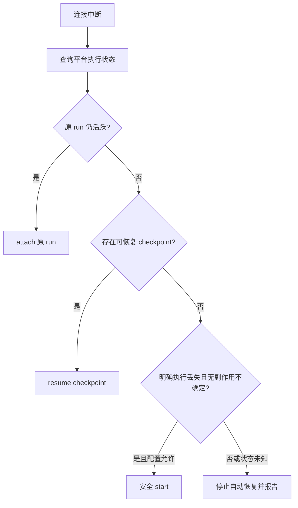

# 执行控制与恢复

执行控制区分服务端操作、本地资源中断和明确的新 run。恢复的第一原则是：状态未知或工具副作用不确定时，不通过重跑任务猜测结果。

## 操作语义

| 操作 | 是否调用服务端 | 是否创建新 run | 说明 |
|------|----------------|----------------|------|
| `pause()` | 是 | 否 | 暂停当前执行 |
| `cancel()` | 是 | 否 | 取消当前执行并清理本地流 |
| `interrupt()` | 否 | 否 | 只中断本地执行与资源 |
| `attach()` | 是 | 否 | 重接原 run |
| `resume()` | 是 | 否 | 恢复可续跑 checkpoint |
| `retry()` | 是 | 是 | 按平台持久化状态续做或重发输入 |
| `repeat()` | 是 | 是 | 复用上一轮输入模板 |

```python
stream = await session.attach()
stream = await session.resume()
stream = await session.resume(checkpoint)
stream = await session.retry()
stream = await session.repeat()
```

## 暂停与恢复示例

```python
checkpoints = await agent.execution.list_resumable(
    await agent.resolve_flow_id(),
    session.session_id,
)
checkpoint = next(
    (item for item in checkpoints if item.run_id == session.run_context.run_id),
    None,
)
if checkpoint is None:
    raise RuntimeError("No resumable checkpoint found")

async for event in await session.resume(checkpoint):
    ...
```

没有可恢复 checkpoint 时应明确失败或交由人工处理，不能改成 `chat()` 伪装恢复。

## MANUAL 与 AUTO

默认 `MANUAL`，由调用方决定何时 attach、resume、retry 或 repeat。

AUTO 按有界退避对账，顺序为：



平台不可达、状态未知、存在 waiting/pending/uncertain 工具副作用或未确认结果未持久化时，禁止自动 start。

## 工具结果 Outbox

工具结果采用先持久化、后 REST 回报：

1. 保存有界瞬态结果或 checkpoint 记录。
2. 调用唯一工具结果 REST 端点。
3. 网络失败保留记录并按预算补传。
4. 补传只提交已保存结果，不重新执行工具。
5. 重试耗尽或结果冲突进入死信并告警。

```python
agent = TaiyiAgent(..., state_dir="./agent-state")
```

重启后的 IDLE 会话可通过 `recover_report(entry)` 重新对账并提交保存的 checkpoint 结果。已持久化不等于平台已接收。

Outbox 有单条字节、条目数、总字节和重试上限；损坏记录隔离。workspace/state 不保存权威业务结果或长期任务历史。

## 异步 FlowRun 的不确定性

非流式异步 FlowRun 提交只接受有效响应与 task ID。提交结果未知时抛出不确定状态，不自动重新 POST；轮询超时保留 task ID 和取消状态。调用方必须依据平台任务记录对账。
